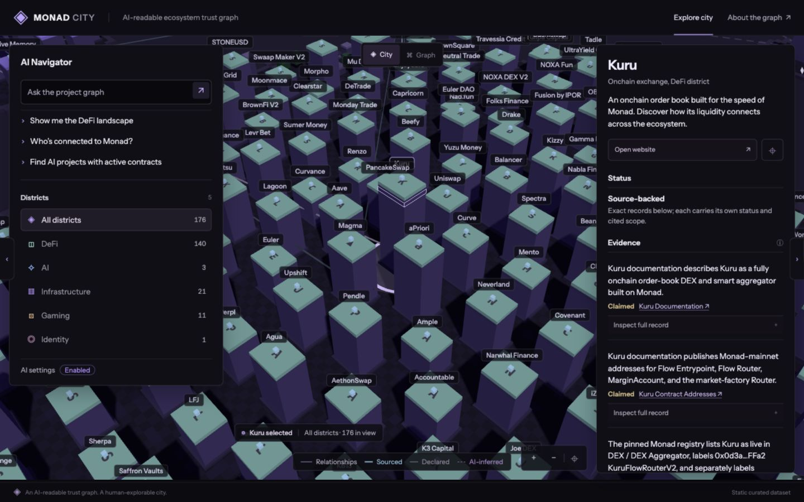

# Monad City

Explore the Monad ecosystem through an interactive city. Find projects, inspect their sources, and see how they connect.

[Open app](https://monad-city.vercel.app/)



## Features

- City and Graph views across 176 projects in five districts.
- Project Passports with sources, bounded claims, and relationship details.
- A deterministic Navigator that finds projects and highlights them on the map without an API key.
- Optional browser-based tool-calling AI for evidence-aware searches.
- 217 approved evidence records, 194 sourced relationships, and 205 total graph edges.
- Read-only publication checks for exact evidence records on Monad Testnet.

Built with vanilla JavaScript, CSS, Three.js, and SVG.

## Getting started

Requires Node.js 18 or newer. No dependency installation is needed.

```sh
npm run dev
```

Open [localhost:5173](http://localhost:5173/). The local Navigator is the default; optional AI settings accept an OpenAI-compatible endpoint, tool-calling model, and user-provided key.

AI settings and the key stay in your browser storage for that site. Queries and retrieved records go directly to your chosen provider; its endpoint must support browser CORS. Localhost settings do not carry over to the public app.

## Development

```sh
npm run build       # verify the evidence and registry bundles, then build dist/
npm run test:ai
npm run test:onchain
npm run test:registry
npm run preview     # serve the built app
```

Project data comes from a checked-in, manually reviewed snapshot. An approved record supports only its exact cited scope; it does not establish project safety, legitimacy, current activity, endorsement, or global verification. Illustrative profiles, placements, geometry, and unsupported relationships remain labeled.

The optional evidence publication registry lives in [contracts](contracts/DEPLOYMENT.md). The current v9 bundle is published on Monad Testnet through registry `0x8d53153a8a25c81701954eed66154b3ebba8b8c7` in transaction `0x71a3ccee9f6d928a9ddb58caa89945dae445c42d33fbcb8e287e160b8296f8e7`. Open a full evidence record and click **Check publication** to check exact inclusion; this does not establish source accuracy or project safety.

See [AI Navigator](docs/AI_NAVIGATOR.md) and [Trust Model](docs/TRUST_MODEL.md) for details.
